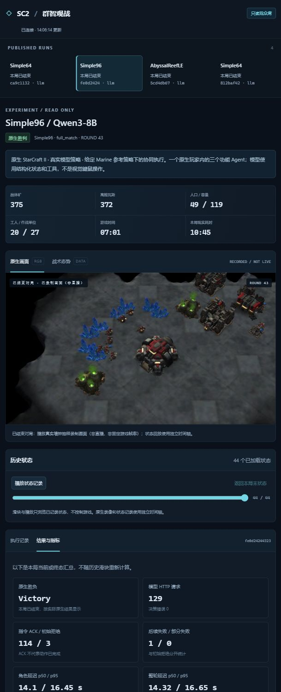

# SC2 Harness · 星际争霸Ⅱ群智实验台

An observable StarCraft II testbed: three function-level agents control one native Terran player through a structured game API. Use an OpenAI-compatible model service, inspect decisions and traces in the browser, and evaluate observed game outcomes.

在真实星际争霸Ⅱ中运行经济、建设生产、侦察作战三个功能 Agent。通过原生游戏 API、网页观测台、eval 和 Trace，检验模型的协作执行；可使用本地 Qwen 等 OpenAI-compatible 服务，无需训练游戏模型。

**当前范围是一个原生人族玩家，对抗一个内置电脑。三个 Agent 分担同一玩家的功能，不是三个独立游戏玩家，也未实现原生队友合作。**



独立只读观众页支持原生录制、战术历史播放、三个角色的公开决策与通信，以及真实胜负和调用指标。管理控制台保留在服务器本机，观众不能创建、暂停或停止任务。分享方式见 [SHARING](docs/SHARING.md)。

已验证的 `b5c474…` 应用版本使用 Qwen3-8B、**给定 Marine 参考策略、VeryEasy 人族对手、seed 7、暂停步进**。在三张地图各取得一局原生 Victory，额外同配置 Simple64 复验自然 Defeat：

| 地图 | 原生结果 | 游戏秒 / 现实秒 | 实际模型请求 | 运行 ID |
| --- | --- | ---: | ---: | --- |
| Simple64 | Victory | 417.50 / 620.47 | 126 | `812baf42d11d4165be6fb5be26998f74` |
| AbyssalReefLE | Victory | 488.57 / 738.86 | 147 | `5cd4db67f22a43e6b00b47794094b435` |
| Simple96 | Victory | 421.43 / 645.95 | 129 | `fe0d242443234e3189a10ea4cba41247` |
| Simple64 复验 | Defeat | 1,081.43 / 1,671.75 | 327 | `ca9c1132125947238e49f9471ce2f4dc` |

三图目标已达成，**三胜一败不能证明稳定可靠**，也不代表默认 `none` 模式或从零自主战略获胜。模型等待时双方游戏暂停，不是实时对战测试。原生 960×540 RGB、回放与实际调用已核对；原始实验数据不随 Git 发布，可向维护者申请核查。

当前尚未接入正式团队框架。后续可替换角色策略 adapter，复用游戏运行器、工具执行、eval、Trace 和网页；接口见 [框架接入](docs/INTEGRATION.md)。

[演示结果与限制](docs/DEMO_RESULTS.md) · [验证历史](docs/VERIFICATION.md) · [只读观战分享](docs/SHARING.md) · [第三方来源与权利边界](docs/THIRD_PARTY.md)

## 模式与任务

运行环境和决策策略是两个独立选项：

| 选项 | 实际运行什么 | 能证明什么 |
| --- | --- | --- |
| `backend=sc2` | 真实 SC2 引擎、地图和规则 | 需结合引擎身份、状态、回放及执行结果确认 |
| `backend=sandbox` | 确定性接口测试适配器 | 网页、协议、运行管理及故障处理；不能证明游戏可用 |
| `policy=scripted` | 固定规则脚本 | 工具与环境基线；不调用模型 |
| `policy=llm` | 三个 Agent 分别调用配置的模型服务 | 需结合实际调用、用量及有效动作确认 |

没有自动降级：原生环境缺失会报错，模型失败不会切换成脚本。网页默认选择原生 SC2；命令行默认策略是 `scripted`，执行时建议始终显式写出这两个选项。

`guidance_profile=none` 默认保留原有角色协商模式；可显式选择 `marine_reference_v1`，作为**给定 Marine 参考策略的 LLM 协同执行基线**。参考模式要求 `full_match + llm + execution_guidance=true`。当前计划 `version=1, revision=3` 先给出 14 工人、1 座完成补给站、1 座完成兵营的开局建议，再进入约 20 工人、2 兵营、12 Marine、4 空余人口的编队建议；每个角色收到自己的参考目标、持续职责及观察进度。12 Marine 是出发参考，不是生产上限，后续仍指导经济供给、持续训练和主力探索。策略由框架明确给定，三个角色实际请求模型并选择合法动作；不增加规划模型或自动游戏动作。`full_match` 仍只以原生 Victory 为成功，软目标及主力到过搜索位置都不能替代胜利。指导模式及源码版本分别统计，不能混成同一组三图成绩。

旧版本胜败、未采用的提示对照和全部诊断停止分别保留于[验证历史](docs/VERIFICATION.md)，不跨源码版本拼接成绩，也不把多项共同变更归因于单项修复。

当前 Agent 读取结构化的可见游戏状态，通过工具调用控制游戏；RGB 用于人的网页观测。这里没有把画面交给视觉模型，也不通过鼠标键盘代替游戏 API。

基础与完整对局任务：

- `build_and_scout`：扩充至 14 名工人，完成补给站和兵营，训练 4 名陆战队员，并让侦察单位实际到达敌方出生区域。里程碑依据观察状态确认。
- `full_match`：进行完整对局，以引擎 `Victory / Defeat / Tie` 判定；预算耗尽而未终局记为 `incomplete`。

另有三个声明式长程任务：扩张与资源供给、升级步兵备战、扩张后赢下对局。目标阶段、真实验收条件与指标见 [长程任务工作表](docs/LONG_HORIZON_TASKS.md)。任务已实现不代表模型已通过，实际结果仍以验证记录为准。

原生适配器当前使用人族，对手为 VeryEasy 内置人族电脑。默认地图为 `Simple64`，需要可运行的完整对战地图，不能直接用预置战斗单位的 SMAC 小地图替代。三种策略对照方法见 [实验说明](docs/EXPERIMENTS.md)。

本版工具覆盖基础经济、建筑、陆战队生产与移动作战；还没有覆盖星际全部兵种、科技树或三个种族的策略。

## 安装与环境检查

建议使用独立 Linux 环境和 Python 3.10–3.12。从本项目源码目录安装：

```bash
python3 -m venv .venv
source .venv/bin/activate
python -m pip install -U pip
python -m pip install -e ".[dev,game]"
python -m sc2_harness doctor
```

`game` 依赖固定为 `burnysc2==6.6.0` 和 `protobuf==3.20.3`，适配器按该 SDK 实现。不要将其他版本的 `sc2` 或 PySC2 包混装到同一环境。依赖约束以 [pyproject.toml](pyproject.toml) 为准。

仅检查网页与接口沙盒时，可以安装 `python -m pip install -e ".[dev]"`。这不会安装 SC2 引擎。

游戏本体和地图需要另行取得，不包含在项目中。Linux 游戏包与使用条件参见 [暴雪官方 API 文档](https://github.com/Blizzard/s2client-proto#downloads)。将完整对战地图放入游戏的 `Maps` 目录，并设置游戏根目录：

```bash
export SC2PATH="/path/to/StarCraftII"
python -m sc2_harness doctor
```

`doctor` 只读检查 SDK、游戏路径、可执行文件、地图列表及模型配置，不启动游戏、不调用模型。`available=true` 只是预检通过，实际地图加载、命令执行、渲染仍需运行验证。

原生游戏 worker 可放在另一个 Python 环境，但那个环境也必须安装本项目及相同的 `game` 依赖：

```bash
export SC2H_GAME_PYTHON="/path/to/game-venv/bin/python"
```

## 配置模型

程序只读取进程环境变量，**不会自动加载 `.env` 或 `.env.example`**。在启动服务的终端显式设置：

```bash
export SC2H_MODEL_BASE_URL="http://127.0.0.1:18891/v1"
export SC2H_MODEL_NAME="Qwen3-8B"
export SC2H_MODEL_CONTEXT_TOKENS=16384
export SC2H_MODEL_API_KEY=""
export SC2H_DATA_DIR="runtime"
```

上面是本地推理服务的地址示例。可按 [本地模型说明](docs/LOCAL_MODEL.md) 使用可选脚本部署官方 Qwen GGUF 和 llama.cpp，三个角色共用一份权重；也可接已有的兼容服务。若服务需要认证，应通过私有环境配置传入真实 Key，不要写入仓库、网页或实验配置。

`SC2H_MODEL_CONTEXT_TOKENS` 声明当前本地服务的已知窗口，不会为服务扩容；更换端点时应按其实际容量修改，并与服务设置核对。

模型接口使用 `POST {SC2H_MODEL_BASE_URL}/chat/completions`，要求结构化 JSON 响应；默认使用不思考的快速配置。每个功能 Agent 有独立的有限历史与状态，共享服务而非共享对话。当前可选的有限推理需要服务兼容 `enable_thinking`、`reasoning_format=deepseek` 和 `reasoning_budget_tokens`；它不是所有兼容服务都会支持的通用保证。

长程调试可显式选择推理预算，实际值保存在运行配置和模型事件中。例如：

```bash
python -m sc2_harness run --backend sc2 --policy llm \
  --map AbyssalReefLE --scenario full_match --seeds 7 \
  --max-rounds 360 --game-seconds 2400 --advance-loops 224 \
  --reasoning-budget-tokens 1024 --output runtime/full-match-reasoning.json
```

预算为 `0` 时沿用快速配置；正值启用有限推理，当前使用总输出上限 1,536 tokens、单轮历史。模型等待期间整个游戏仍暂停。记录只包含公开决策、实际用量和是否收到推理内容的布尔值，不保存私有推理正文。配置可用、JSON 合法与真正赢下游戏分别验收。

更改模型环境变量后，需要重启工作台进程。`doctor` 显示“已配置”不代表成功完成了一次推理。

## 启动网页

在上述环境变量所在终端运行：

```bash
python -m sc2_harness serve --host 127.0.0.1 --port 18890
```

打开 <http://127.0.0.1:18890/>，新建实验并显式选择环境和策略。工作台提供实验历史、开始/暂停/继续/停止、资源与单位状态、Agent 决策、实际通信、事件时间线、指标和证据下载。

部署在远程服务器时，建议保留 loopback 监听，通过 SSH 转发访问。在自己的电脑另开终端：

```bash
ssh -N -L 18890:127.0.0.1:18890 SSH_ACCOUNT@SERVER_LAN_IP
```

再打开电脑本地的同一地址。当前控制台没有登录系统，不应直接暴露为公共服务。向他人分享应使用隔离的只读观战入口；部署方式与 SSH 示例见 [SHARING.md](docs/SHARING.md)。SSH 占位、端口和密钥按获准使用的服务器配置填写。

## 运行一局与批量评测

`run` 和 `evaluate` 都通过 HTTP 控制已经启动的工作台，不会代替 `serve`。在另一个终端、同一 Python 环境执行：

```bash
# 本地接口检查：明确不是原生游戏，也不调用模型。
python -m sc2_harness run --backend sandbox --policy scripted \
  --seeds 7 --output runtime/sandbox-check.json

# 原生 SC2 + 脚本基线。
python -m sc2_harness run --backend sc2 --policy scripted \
  --map Simple64 --scenario build_and_scout --seeds 7 \
  --output runtime/native-scripted.json

# 原生 SC2 + 模型决策。
python -m sc2_harness run --backend sc2 --policy llm \
  --map Simple64 --scenario build_and_scout --seeds 7 \
  --output runtime/native-llm.json

# 相同配置顺序运行多个种子，导出逐局结果。
python -m sc2_harness evaluate --backend sc2 --policy llm \
  --map Simple64 --seeds 7,19,41 \
  --output runtime/evaluation-llm.json

# 显式给定参考策略的协同执行基线；成功仍需原生 Victory。
python -m sc2_harness run --backend sc2 --policy llm \
  --map AbyssalReefLE --scenario full_match --seeds 7 \
  --guidance-profile marine_reference_v1 --reasoning-budget-tokens 512 \
  --max-rounds 360 --game-seconds 2400 --advance-loops 224 \
  --output runtime/reference-full-match.json
```

任务预算使用 `--max-rounds`、`--game-seconds`，关闭通信使用 `--no-communication`，远程/其他端口工作台使用 `--url`。`--seeds` 是逗号分隔列表，`run` 也使用这个参数名。运行中断后不自动重放动作或接着控制原局；保存记录供检查，重跑需新建实验。

## 时间、画面与验收口径

原生对局使用 `realtime=False`：运行器一次性提交当前轮的动作，再推进指定的 game loops。**等待模型期间整个游戏世界不推进，对手也不会继续行动。** 暂停请求在当前操作收尾后生效。模型延迟、现实耗时和游戏时间分别记录，不能将步进模式成绩直接称为实时对抗能力。

网页的两种视图严格区分：

- **原生画面**：来自 `/api/runs/{id}/frame` 的 SC2 RGB 帧，没有帧时显示不可用。
- **战术态势**：根据真实 observation 绘制的 Canvas 示意；沙盒也能提供这种视图，因此看见战术图不等于真实引擎或原生渲染已通过。

Linux 渲染后端可通过 `SC2H_RENDER_BACKEND=software|egl|none` 配置。`software` 使用 OSMesa，`egl` 使用 EGL；需要对应共享库和可用驱动。不要只检查库存在就宣布 RGB 正常，须取得实际图像验证。`none` 明确关闭原生 RGB。

历史状态重建依据保存的 snapshots，并非游戏视频。原生 `.SC2Replay` 需对应的 SC2 版本和地图播放，不能直接在浏览器中当作视频打开。

结果记录分为指令提议、验证、引擎接受、观察到的效果、任务结果和游戏胜负。`accepted` 只表示命令被接受，不能等同于建筑完成、造兵成功、任务通过或游戏获胜。

## 记录、测试与代码结构

每局数据保存在 `SC2H_DATA_DIR` 下，包含配置、事件、状态、指标及可用的原生回放。网页“回放与证据”可下载允许导出的文件。模型 Key 不进入公共配置；共享前仍应审阅实验提示词、消息及状态是否含团队业务内容。

```bash
python -m pytest
python -m ruff check sc2_harness tests
```

最新 `b5c474…` 候选检查为 Windows 540 项通过、2 项符号链接权限检查跳过，Linux 542 项通过，Ruff 通过。网页代码未改，沿用此前通过的 16 项 Node 回归。这些测试检验协议、模型调用解析、运行控制、隔离与沙盒行为；通过测试不替代真实模型效果或原生对局验收。实际结果应附运行 ID、配置和证据，不在本文预填成功率或耗时。

| 路径 | 职责 |
| --- | --- |
| [runtime.py](sc2_harness/runtime.py) | 唯一推进实验的运行器、三 Agent 调度、指令与观察记录 |
| [policies.py](sc2_harness/policies.py) | 脚本基线、模型客户端、每角色上下文、结构化决策 |
| [tools.py](sc2_harness/tools.py) | 功能 Agent 工具权限、参数验证与资源仲裁 |
| [backends/native.py](sc2_harness/backends/native.py)、[native_worker.py](sc2_harness/native_worker.py) | 原生游戏进程、SDK 交互、真实动作与状态 |
| [backends/sandbox.py](sc2_harness/backends/sandbox.py) | 显式接口沙盒，不是 SC2 模拟替代证据 |
| [evaluation.py](sc2_harness/evaluation.py) | 从观察状态判定里程碑与任务结果 |
| [storage.py](sc2_harness/storage.py)、[app.py](sc2_harness/app.py) | 持久化、HTTP/WS、允许下载的证据 |
| [web/](sc2_harness/web/) | 无外部 CDN 的网页观测台 |

外部团队框架后续可替换决策策略，通过观察、消息、工具提议和回执接入，复用游戏运行器、网页及评测。当前未完成正式框架集成，也未实现多原生玩家盟友对局。接口详见 [CONTRACTS.md](docs/CONTRACTS.md)。本仓库目前未声明独立源码许可证；第三方组件、模型与游戏资产的来源及权利边界见 [THIRD_PARTY.md](docs/THIRD_PARTY.md)。
